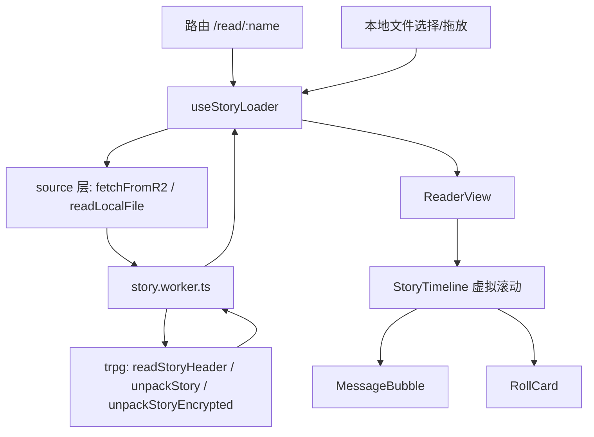

# Bookshelf 设计方案

在线 `.story` 跑团日志阅读器。复用 aemeath-frontend 的配色与 AppBar 观感，用 `@aemeath-projects/trpg` 的 story 解析器解包，纯静态站 + PWA。

## 一、已确认的决策

| 项 | 决策 |
|---|---|
| 文件来源 | 本地上传（仅临时打开，不入库）+ Cloudflare R2 公开直连 |
| R2 端点 | 环境变量 `VITE_R2_ENDPOINT` |
| 路由映射 | `/read/:name` → R2 上的 `${name}.story`，自动补扩展名 |
| 阅读形态 | 聊天流 + 掷骰卡片 |
| trpg 联调 | `package.json` 写 `"link:../aemeath-projects/trpg"` |

## 二、调研结论（本方案的事实依据）

### 2.1 `.story` 格式

二进制容器：8 字节头（magic `STORY` + version + flags + reserved）+ 可选 salt(16B)/nonce(12B) + payload（msgpack，可选 gzip，可选 AES-256-GCM）。

要用到的 API（均已在 `dist/story/index.js` 中，仅依赖 `fflate` + `msgpackr`，**无 node: 内置模块**，浏览器安全）：

- `readStoryHeader(bytes)` → `{ version, compression, encrypted }`，只读前 8 字节，零成本探测
- `isSupportedStoryVersion(version)` → 解包前做能力判断，避免用 catch 做控制流
- `unpackStory(bytes)` → 同步，未加密归档
- `unpackStoryEncrypted(bytes, password)` → 异步，加密归档
- `StoryFormatError` / `StoryDecryptError` → 区分「文件坏了」与「口令错了」
- `MIN_PASSWORD_LENGTH`（8）、`PBKDF2_ITERATIONS`（600_000）

数据模型：`StoryDocument = { meta, actors[], characters[], entries[] }`。`entries[].actor` / `.character` 是 `actors` / `characters` 的**下标**（字典化去重），渲染时需回查。`entry.type` 为 `'message' | 'roll'`，`entry.roll.outcome` 取值为 `great_success | extreme_success | hard_success | success | fail | great_fail`。

### 2.2 两处必须防御的边界

**解析器的校验不是全覆盖的。** 读过 `v1.ts:47-124`，`assertValidV1Document` 校验了 meta 的 `logName/createdBy/source`（string）、`startedAt`（number）、三个数组的存在性、以及所有 actor/character 下标不越界，但**未**校验：

- `entry.type` —— 可能缺失或是未知值
- `entry.roll` 的内部形状 —— `expression/total/detail/rolls` 都没校验
- `meta.endedAt` / `durationMs` / `entryCount` / `exportedAt` —— 只有 `startedAt` 被校验为 number

所以 UI 层要有 fallback：`type` 缺失时按有无 `text` 推定为 message，未知 type 渲染成中性占位；`roll` 形状不全时退回显示 `entry.text`；meta 的数字字段渲染前判 `typeof`。

**`noUncheckedIndexedAccess: true`**（`tsconfig.app.json:9`）。`actors[entry.actor]` 的类型是 `StoryActor | undefined`，即使解析器保证了下标不越界，类型系统仍要求显式兜底。回查逻辑统一收在一个 helper 里，不在模板里散落 `?.`。

### 2.3 aemeath 的视觉资产（原样复用）

`src/themes.ts:14-63` 的 `aemeath` 主题，颜色 token 逐字照搬：

```
light: primary #22DFF2  secondary #E66A9F  accent #F0B34A  error #D62451
       info #1F8FE0  success #16B8A6  warning #E8935B
       background #FFF3F8  surface #FFFFFF
       on-background #1A1A2E  on-surface #1E293B  on-primary #073040 ...
dark:  primary #3FFEFB  secondary #F595C2  accent #FFC873  error #FF6F91
       info #4FC3F7  success #2FE0C9  warning #FFB26B
       background #100E33  surface #1B1846
       on-background #E2E8F0  on-surface #CBD5E1  on-primary #052A2E ...
```

AppBar（`App.vue`）的构成：`v-app-bar color="primary"` + `v-app-bar-nav-icon` + `v-app-bar-title` + `v-spacer` + 一串 `v-tooltip` 包裹的 `v-btn icon`。主题偏好按钮开一个 `max-width="300"` 的 `v-dialog`，内含 light/dark/followOS 三选 `v-radio-group`。

主题状态（`stores/theme.ts`）：pinia + persistedstate，`persist: { key, pick: ['theme','preference'] }`，三档偏好 `light|dark|followOS`，`followOS` 时监听 `matchMedia('(prefers-color-scheme: dark)')` 的 change 事件，在 `onMounted` 里调 `initTheme(vuetifyTheme)`。

**两处刻意偏离**：

1. 原 AppBar 用了 `prominent`（Vuetify 4 下高度很大）。阅读器要把垂直空间让给正文，改用默认密度 + `flat`，仅保留 `color="primary"`。
2. 不复刻 `layouts/Menu.vue`（483 行、由 route meta 驱动的 mega-menu）。Bookshelf 只有首页和阅读页两个路由，导航用不到它。

## 三、依赖变更

新增运行时依赖：

- `@aemeath-projects/trpg`: `link:../aemeath-projects/trpg`（同盘相对路径，路径记录进仓库）
- `@mdi/font`: `^7.4.47`（当前未安装，但 AppBar 的图标按钮依赖 mdi）

新增开发依赖：

- `vite-plugin-pwa`: `1.3.0`（已核实其 peer 声明含 `vite: ^8.0.0`，与本项目 Vite 8 兼容）
- `vite-plugin-vuetify`: `^2.1.3`（按需引入组件，替掉 `main.ts` 里当前的全量 `import * as components`）

新增 `pnpm-workspace.yaml`：

```yaml
allowBuilds:
  msgpackr-extract: false
```

trpg 刻意不编译 `msgpackr-extract` 这个可选 native 加速器，以保持 story 模块「Node + 浏览器双端纯 JS」的前提。bookshelf 侧必须跟着禁用，否则会拉进平台相关的二进制产物。msgpackr 缺少它时自动 fallback 到纯 JS，编解码结果一致。

**前置动作**：`dist/` 的时间戳比 `src/` 早约 35 分钟（大概是 checkout 造成的）。联调前先在 trpg 里跑一次 `pnpm build`，避免 bookshelf 消费到过期的解析器。

## 四、架构



分层意图：**source 层只管拿到字节**，不认识 story 格式；**worker 只管把字节变成文档**，不认识 UI；**composable 只管状态机**，不认识字节。这样以后 R2 换成 Worker 预签名，只改 source 层一处。

### 4.1 为什么用 Web Worker

`unpackStory` 内部是 `gunzipSync` + msgpack 同步解码，主线程直接调用会在大归档上造成掉帧。加密路径的 PBKDF2 是 600_000 次迭代，虽然 `crypto.subtle` 本身异步，但整条链路放进 worker 更干净，且解析不可信字节流天然适合隔离。

代价是错误对象过不了 `postMessage`（类身份会丢）。worker 里把异常映射成判别式码回传，主线程侧再还原成用户可读文案：

```
{ ok: false, code: 'format' | 'decrypt' | 'unsupported-version' | 'unknown', message: string }
```

这部分约 20 行，是清楚可控的成本。

### 4.2 文件清单

```
src/
  themes.ts                       aemeath 配色 token（照搬）
  plugins/vuetify.ts              createVuetify：mdi 图标 + zhHans + 双主题
  stores/theme.ts                 主题偏好，persistedstate（照搬结构）
  stores/settings.ts              阅读偏好：字号、是否加载远程头像
  layouts/AppShell.vue            v-app + v-app-bar + v-main
  components/AppBar.vue           标题、主题偏好按钮、GitHub、返回
  components/ThemeDialog.vue      light/dark/followOS 三选
  views/HomeView.vue              拖放/选择本地文件 + 输入 R2 名称跳转
  views/ReaderView.vue            阅读页：加载态/错误态/口令态/正文
  components/reader/
    StoryTimeline.vue             虚拟滚动容器
    MessageBubble.vue             发言气泡（头像 + 名称 + 时间）
    RollCard.vue                  掷骰卡片（表达式/明细/成功等级）
    StoryMetaPanel.vue            日志名、KP、时长、条目数
    CharacterSheet.vue            人物卡快照（按 ruleset 分组展示 attributes）
    PasswordPrompt.vue            加密归档口令输入
  composables/
    useStoryLoader.ts             加载状态机：idle→fetching→parsing→need-password→ready|error
    useStoryIndex.ts              actor/character 下标回查 + 时间格式化
  services/
    storySource.ts                fetchFromR2(name) / readLocalFile(file) → Uint8Array
    storyClient.ts                worker 封装，Promise 化
  workers/story.worker.ts         解包 + 错误码映射
  router/index.ts                 路由表
env.d.ts                          ImportMetaEnv 增加 VITE_R2_ENDPOINT
.env.example                      VITE_R2_ENDPOINT 示例
```

### 4.3 路由

```
/                    HomeView
/read/:name(.*)      ReaderView，source='r2'
/local               ReaderView，source='local'（文档在内存，刷新即失效）
```

`:name(.*)` 用通配是因为 R2 key 可能含斜杠子目录。请求前对每个路径段做 `encodeURIComponent`（key 可能含中文），拼成 `${VITE_R2_ENDPOINT}/${encodedName}.story`。

`/local` 刷新后文档丢失是既定行为（已选「仅临时打开，不入库」），此时显示「请重新选择文件」并给回首页的入口，而不是报错。

## 五、错误处理

| 场景 | 处理 | 用户看到 |
|---|---|---|
| R2 404 | 区分状态码 | 「未找到该日志：{name}」+ 回首页 |
| R2 403 / CORS 失败 | 区分状态码与网络错误 | 「无法访问该日志，可能是存储桶未开放跨域」 |
| 网络中断 | fetch reject | 「网络不可用，请检查连接后重试」+ 重试按钮 |
| magic 不匹配 / 字节截断 | `StoryFormatError` | 「这不是有效的 .story 文件」 |
| 版本超前 | `isSupportedStoryVersion` 前置判断 | 「该日志由更新版本的程序生成，请升级阅读器」 |
| 加密归档 | header `encrypted` 为真 | 口令输入界面，不是错误 |
| 口令错误 | `StoryDecryptError` | 「口令错误，或文件已损坏」，保留输入 |
| 口令过短 | 前端按 `MIN_PASSWORD_LENGTH` 预校验 | 提交按钮禁用 + 「至少 8 个字符」 |
| 非 HTTPS 下开加密文件 | `crypto.subtle` 为 undefined | 「加密日志需要 HTTPS 环境」 |
| entry 字段缺失/异常 | §2.2 的 fallback | 中性占位，不整页崩 |

## 六、安全

- **`entry.text` 一律按纯文本渲染，不走 HTML。** 格式规范明确「归档只存纯文本」，引入 markdown 渲染等于给不可信归档开一条注入通道，没有对应收益。这是有意不做 markdown。
- **远程头像默认关闭。** `actor.avatar` 是指向 QQ 头像服务的活引用，加载它会把「谁在什么时候读了这份归档」泄漏给第三方 CDN，且离线时必然失败。默认渲染姓名首字，在设置里提供开关。
- 口令只存在组件局部 state，不进 pinia、不持久化、不入 URL。
- R2 走公开直连，前端不持有任何密钥。

## 七、PWA

`vite-plugin-pwa`，`registerType: 'prompt'`（有更新时提示而非静默重载，避免读到一半被刷掉）：

- 预缓存应用外壳，离线可打开
- manifest：名称 Bookshelf、主题色 `#22DFF2`、standalone
- `.story` 的 R2 响应做运行时缓存（CacheFirst），使读过的日志离线可重读

最后一条需要点明：这是 HTTP 传输层缓存，不是「入库」，与「仅临时打开」的决策不冲突。但它确实会让文件字节留在浏览器 Cache Storage 里。如果不希望如此，去掉这条即可，其余 PWA 能力不受影响。

## 八、测试

沿用现有 vitest + jsdom。

- `storySource`：URL 拼接（含中文与子目录 key 的编码）、404/403/网络错误的分支
- `useStoryIndex`：下标回查的兜底、时间偏移格式化
- 防御性渲染：构造 `type` 缺失、`roll` 形状不全、meta 数字字段为非数字的文档，断言不抛异常
- `RollCard`：六种 outcome 的展示映射
- 组件冒烟：`MessageBubble` / `RollCard` / `StoryMetaPanel`

测试样本需要自己造——trpg 仓库里没有现成 `.story` 文件（已确认）。用 `packStory` 按 `tests/unit/story/story.test.ts:21` 的 `makeDoc` 形状生成一个 fixture，同时生成一份加密的用于口令流程。

## 九、实施顺序

1. 装依赖、加 `pnpm-workspace.yaml`、trpg 侧 `pnpm build`、验证 `import` 能通
2. 主题层：`themes.ts` + `plugins/vuetify.ts` + `stores/theme.ts`，改 `main.ts` 为按需引入
3. 外壳：`AppShell` + `AppBar` + `ThemeDialog`，确认明暗切换与持久化
4. 解析链路：worker + `storyClient` + `storySource` + `useStoryLoader`，先用 fixture 打通
5. 阅读 UI：`StoryTimeline` + `MessageBubble` + `RollCard` + `StoryMetaPanel` + `CharacterSheet`
6. `HomeView` 与路由，本地上传与 R2 两条入口
7. `PasswordPrompt` 与加密流程
8. PWA 配置 + manifest 图标
9. 测试补齐，跑 `pnpm type-check` / `lint` / `test:unit`

## 十、待确认

- **R2 里没有列目录的能力**（公开桶不提供 list）。所以首页无法展示「R2 上有哪些日志」，只能让用户输入名称或通过直链进入。若希望首页有可浏览的列表，需要额外维护一份索引 JSON 放在 R2 上——本方案暂不含此项。
- manifest 图标需要 192/512 两个尺寸的 PNG。当前 `public/` 只有 `favicon.ico`。可以先用占位图跑通，图标资源后补。
